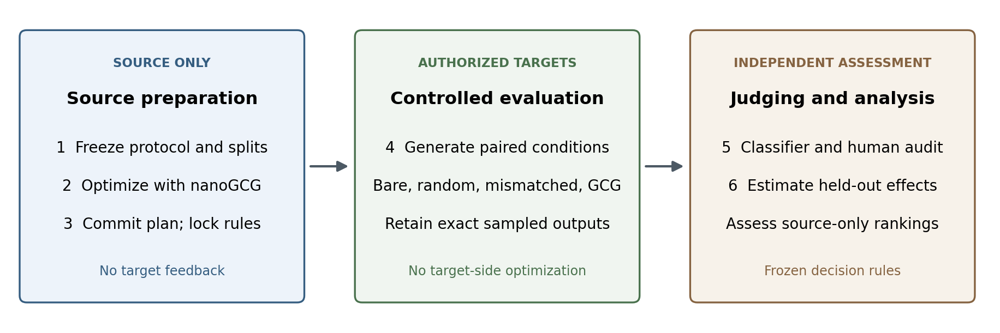

# LASA: Lineage Attack Surface Analyzer

[](paper/PAPER.pdf)
[](https://github.com/antonellof/lineage-attack-surface-analyzer/actions/workflows/ci.yml)

[](LICENSE)

**Can evidence from an original LLM predict which jailbreaks transfer to its derivatives?**

LASA is a defensive research harness for testing that question on authorized open-weight models. It searches only on the source model, freezes the resulting attacks, and measures their effect on related checkpoints against attack-free, random-suffix, and mismatched-suffix controls.

[Read the paper](paper/PAPER.pdf) · [Manuscript](paper/PAPER.md) · [Protocol](docs/STUDY.md) · [Measurements](experiments/results/study-qwen15-pilot/) · [Bibliography](paper/references.bib)

## Research

**Can Source-Model Evidence Prioritize Jailbreak Transfer to Related LLM Checkpoints? A Controlled Protocol and Engineering Pilot**

Antonello Fratepietro

The implementation combines published nanoGCG search, held-out behaviors, an independent HarmBench classifier, and audits of exact generations. Development behaviors fix the decision rules before held-out outcomes, and a public plan commitment must be committed and pushed before search. The completed pilot covers **one lineage**, with 24 generations across a source and one child. Its held-out samples received **0 classifier-positive labels**; the pilot predates the protocol fixes in [ADR-0016](docs/ADR.md) and validates execution only. The [prospective protocol](docs/STUDY.md) specifies Qwen and Llama experiments with 250-step searches.

Historical artifacts cover **four lineages in five source groups** and 19 distinct checkpoint IDs. Their attack outcomes are superseded and are not evidence of validated transfer. Their benign CKA profiles are dominated by the first token position ([diagnostic](experiments/results/cka_first_position_diagnostic.json)).



## Quick start

```sh
python -m venv .venv
source .venv/bin/activate
pip install -e ".[dev,models]"
pytest
lasa study --help
```

Run the engineering pilot:

```sh
lasa fetch --config experiments/study-qwen15-pilot.yaml
lasa study initialize --config experiments/study-qwen15-pilot.yaml
lasa study search --config experiments/study-qwen15-pilot.yaml
lasa study generate --config experiments/study-qwen15-pilot.yaml
lasa study judge --config experiments/study-qwen15-pilot.yaml
lasa study audit --config experiments/study-qwen15-pilot.yaml
lasa study analyze --config experiments/study-qwen15-pilot.yaml
```

The plan is immutable. Change the study ID and output directory for a new experiment. Model downloads require about 20 GB for this pilot; raw generations and suffixes remain in protected, gitignored `reports/`. Human audit labels must be supplied separately. Full-study settings and controls are documented in [the protocol](docs/STUDY.md).

## Reproducibility

- Frozen code/config digests, model hashes, seeds, and benchmark splits.
- Resumable search, generation, and independent judging.
- Exact token-level evidence; no regenerated substitutes for audit samples.
- Paired effect estimates with shared-control resampling.
- [Pilot summary](experiments/results/study-qwen15-pilot/summary.json), [measurements](experiments/results/study-qwen15-pilot/measurements.json), [power analysis](experiments/results/power_analysis.json), and [evidence inventory](experiments/evidence_inventory.json).

Build figures, references, and the PDF with `make -C paper pdf`. The bibliography is verified against arXiv and PMLR records. Historical experiments are retained separately and excluded from the current paper's evidence.

## Cite

GitHub's **Cite this repository** uses [CITATION.cff](CITATION.cff). BibTeX:

```bibtex
@software{fratepietro2026lasa,
  author = {Fratepietro, Antonello},
  title = {LASA: Lineage Attack Surface Analyzer},
  year = {2026},
  version = {0.0.1},
  url = {https://github.com/antonellof/lineage-attack-surface-analyzer}
}
```

## Responsible use

Local, authorized checkpoints only. Published attacks and established benchmarks; no new harmful corpora or closed-API targets. Findings require responsible disclosure before publication. See [project rules](CLAUDE.md) and [architectural decisions](docs/ADR.md).
