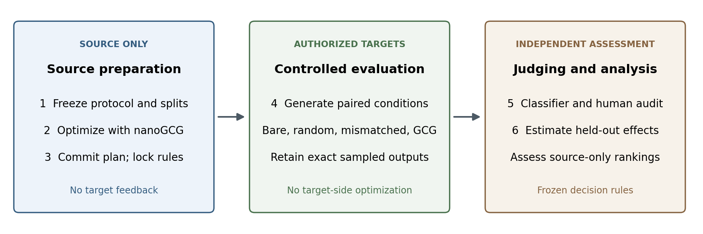
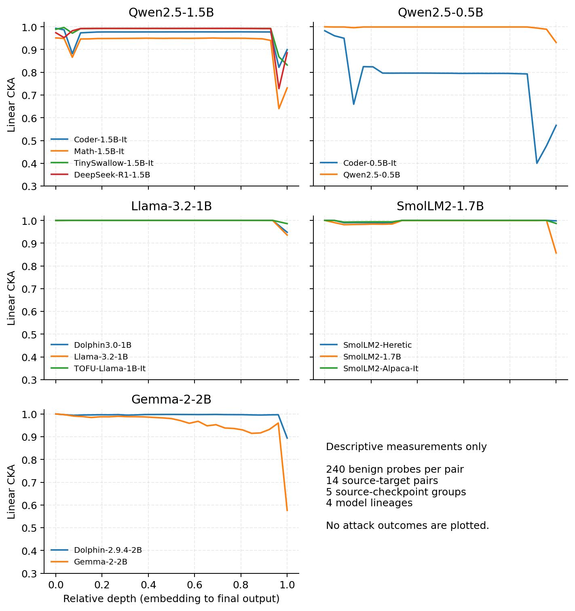

# Can Source-Model Evidence Prioritize Jailbreak Transfer to Related LLM Checkpoints? A Controlled Protocol and Two Confirmatory Studies

Antonello Fratepietro

Code and data: https://github.com/antonellof/lineage-attack-surface-analyzer

Email: antonello.f@gmail.com

Date: 13 November 2026

## Abstract

Open-weight language models are common starting points for specialized derivatives such as fine-tunes. A defender who owns several derivatives of one source model must decide which inherited jailbreaks to evaluate first. We ask whether measurements taken on the source model alone can order that work better than chance. LASA (Lineage Attack Surface Analyzer) tests this with a protocol whose analysis rules are frozen before any outcome is seen. The attack is Greedy Coordinate Gradient (GCG), a published method that searches for a short token sequence, called a suffix, which makes a model comply with a harmful request when appended to it. Each suffix is optimized on the source model only, and the derivatives are never used in the search. Each derivative then receives four versions of every request: the request alone, the request with a random suffix of the same length, the request with a GCG suffix optimized for a different request, and the request with its own GCG suffix. A separate classifier labels every generated output as harmful compliance or not. Thirty development requests fix the decision rules. Thirty held-out requests then test two things, with Holm correction for multiple comparisons: whether the suffix raises the compliance rate above the controls (incremental compliance), and whether a score computed on the source alone picks the five requests with the largest increase (prioritization). We ran the protocol on two source models, Qwen2.5 1.5B and Granite 4.1 3B, with seven derivatives and 10,800 exact generations. The attack worked on both sources, raising the classifier-positive rate by 0.74 and 0.45. Five derivatives were eligible primary targets, meaning that they did not already comply without an attack. One of them, a Qwen sibling model, showed incremental compliance over both the bare request and the random suffix (increase 0.35). On that model a suffix optimized for a different request did nearly as well, so most of the effect is not specific to the request. The one primary Qwen fine-tune showed no increase (95% interval -0.02 to 0.10), while a router fine-tune outside the primary set showed an increase of 0.64. Source-only prioritization was not supported on any target. On two Granite derivatives the suffix text mapped to different token IDs for 27 of 30 held-out requests, which limits what their null results mean. All outcomes are classifier labels. The planned two-annotator human audit of the classifier was not run. After the outcomes were known we replaced it with an audit by two language-model labelers per study, who agreed with each other on at least 95% of 120 sampled outputs. They confirmed 47% and 55% of the sampled classifier positives in the Qwen study and 77% in the Granite study, against the 80% that the frozen criterion asks of human annotators. The classifier therefore overstates harmful compliance, and we make no claim about harmful-compliance rates. Building the pipeline also exposed three measurement errors, each now fixed and tested: evaluated prompts that did not reproduce the optimized tokens, a classifier prompt template taken from another model, and a representation-similarity measurement (centered kernel alignment) dominated by the first token position.

## 1. Introduction

An open-weight checkpoint can have many derivatives. A defender who owns several of them needs to decide which inherited weaknesses to evaluate first. Source-model access lets the defender develop attacks once instead of adapting them to every target. It does not show that a resulting prompt transfers, or that a source measurement predicts which prompts will.

The attack studied here is Greedy Coordinate Gradient (GCG) [@zou2023gcg]. GCG uses a model's gradients to search for an adversarial suffix: a short token sequence that, appended to a harmful request, makes the model begin a compliant answer. In this study every suffix is optimized on the source model only. The question is what happens when the same suffix is given to a related model that took no part in the search.

We use the following terms. The *source* is the open-weight model on which attacks are developed. A *target* or *derivative* is a related model that is evaluated. A *child* is fine-tuned from the source, and a *sibling* descends from the same pretrained parent through another branch. A *checkpoint* is one specific released set of weights. A *behavior* is one harmful request from a public benchmark. *Compliance* means that the model carries out the behavior instead of refusing. *Uplift* is the increase in compliance rate that a suffix produces over a control condition. *Incremental compliance* is uplift over both the bare request and a random suffix. A target has *headroom* when it does not already comply with most bare requests, so that an increase can be observed.

We ask three questions:

1. Does a source-derived suffix increase harmful compliance on a derivative, relative to the same request without an attack?
2. Does it beat suffixes that were not optimized for the request: a random suffix of matched source token length, and a suffix optimized for a different behavior?
3. Do source-only scores select attacks with larger target uplift than random selection on held-out behaviors?

The project started from a broader hypothesis: that transfer is predictable from attack strength on the source and from representational similarity between source and target. The studies test only the first part. Similarity varies across targets, not across behaviors, and each study has at most three primary targets. A test of similarity needs many derivatives per source. Appendix A also shows that the similarity measure used in earlier runs mostly tracked the first token position.

The short answers, for the classifier-based outcome, are these. For question 1, yes on one of five primary targets with headroom. For question 2, the suffix beat the random control on that target but not the mismatched one. For question 3, no. A post hoc model audit then found that the classifier overcounts harmful compliance, most of all in the Qwen study (Section 6.8), so even the one positive answer is about classifier labels.

This paper makes four contributions:

- A controlled estimand and protocol for source-only prioritization. It measures incremental compliance over three controls, fixes development-split rules before outcomes, freezes decision rules and a classifier-validity criterion with a design-stage power analysis, and requires a pushed plan commitment before search.
- An implementation that keeps exact evidence (token IDs, completions, seeds) and stops when a plan, checkpoint, rubric, or environment changes.
- Two confirmatory studies under that protocol, on Qwen2.5 1.5B and Granite 4.1 3B, reported with their null results and with a post hoc model audit that does not support the classifier.
- Three measurement pitfalls for source-only transfer studies, each quantified and fixed: prompt reconstruction that changes the optimized tokens, a classifier prompt template taken from a different model, and mean pooling that lets the first token position dominate centered kernel alignment (CKA), a measure of similarity between two models' internal representations.

The contribution is methodological and empirical. The attack, benchmark, and classifier are prior work.



## 2. Related work

### 2.1 Transfer prediction and lineage

Angell et al. study transfer across 20 open-weight models and 33 attacks and associate it with source attack strength and benign representational similarity [@angell2025transfer]. Their benign-only distillation experiment also examines whether increasing similarity increases transfer. This work motivates source measurements as candidate predictors.

Tan et al. are closest to this study [@tan2025inheritance]. With white-box access to a pretrained model and black-box access to its fine-tuned derivatives, they find that GCG prompts optimized on the pretrained model transfer best to its derivatives, across seven pretrained models with five task-specific fine-tunes each. They also find that transferable prompts are linearly separable in the pretrained model's hidden states, and they build a probe-guided attack on that signal. LASA asks a narrower, defensive question in the same setting. It measures incremental compliance against three controls rather than raw attack success. It scores fixed source measurements on held-out behaviors against random selection. It labels exact outputs with an independent classifier, audits a sample of those labels, and reports null results. Our sources are instruction-tuned checkpoints, and the derivatives are public checkpoints that the operator runs under an authorization record. A source-side probe in the spirit of Tan et al., trained on development behaviors only, is a natural third score for a later protocol.

Meade et al. optimize GCG triggers on 13 open models and find that transfer between models is inconsistent [@meade2024triggers]. They also find that models aligned by fine-tuning are more susceptible than models aligned by preference optimization. Inconsistent transfer is the reason this study treats transfer to a related checkpoint as a quantity to measure per target, with controls, and not as a default assumption.

Wang et al. study the grey-box problem for fine-tuned vision-language models with simulated fine-tuning trajectories [@wang2025sea]. LASA is restricted to text suffixes on small text-only checkpoints.

Table: Prior work closest to this study.

| Study | Main focus | Relation to this study |
| :--- | :--- | :--- |
| Angell et al. [@angell2025transfer] | Strength and similarity across 20 models | Motivates source-side predictors |
| Tan et al. [@tan2025inheritance] | Pretrained-to-fine-tuned transfer; source probes | Same threat model; raw success and a learned probe |
| Wang et al. [@wang2025sea] | Transfer across fine-tuned VLMs | Grey-box setting; different modality |
| Present study | Source-only prioritization | Incremental compliance, held-out rules, audited labels |

### 2.2 Attacks and evaluation

Greedy Coordinate Gradient (GCG) optimizes discrete adversarial suffixes using source-model gradients [@zou2023gcg]. LASA wraps nanoGCG 0.3.0, a compact reference implementation of GCG [@nanogcg]. AmpleGCG learns a suffix generator from GCG-derived candidates [@liao2024amplegcg]; we do not train such a generator. JailbreakBench supplies the behaviors and their published target strings [@chao2024jailbreakbench]. HarmBench provides the classification framework and rubric [@mazeika2024harmbench]. HarmBench designates a Llama-2-13B model as its official text classifier and also releases a Mistral-7B validation classifier [@harmbenchclassifier]. This study uses the 7B classifier, which fits the available hardware, with the prompt template published on its own model card. Agreement with the 13B classifier on the audited sample would be a useful sensitivity check. Both classifiers were trained for HarmBench behaviors, which overlap with but differ from JailbreakBench. Souly et al. show that automated jailbreak judges often credit responses that are compliant in form but empty in content [@souly2024strongreject]. That is the reason for the human audit and its frozen criterion (Section 4.5).

Qi et al. show that fine-tuning can remove safety behavior even when the fine-tuning data is benign [@qi2023finetuning]. A derivative may therefore comply with a bare request. The bare-prompt control and the headroom rule (Section 4.6) keep such compliance from being counted as transfer.

Arditi et al. identify a refusal-mediating direction in the residual stream [@arditi2024refusal]. Ablating it requires white-box target access and differs from transferring a prompt. We keep the historical ablation analysis out of the prompt study. Centered kernel alignment (CKA) compares neural representations [@kornblith2019cka]. This study makes no claim about its predictive value; Appendix A reports a problem with how it was measured in earlier runs.

## 3. Threat model and lineage

The operator controls the evaluated checkpoints or runs public research models on infrastructure the operator controls. Verification requires a schema-validated authorization record. No closed API or third-party target is in scope.

GCG optimization uses only the source checkpoint. Suffixes and ranking rules are fixed before target judgments. Target generations are observations for independent judging, never feedback for optimization. The classifier is a distinct checkpoint and runs after the evaluated models are released from memory.

Children are initialized from the source Instruct checkpoint. Siblings share a pretrained parent with the source through another branch. The Qwen study uses Qwen2.5-1.5B-Instruct as source [@qwen15], TinySwallow and Arch-Router as declared children [@tinyswallow; @archrouter], and Qwen2.5-Coder-1.5B-Instruct and Qwen2.5-Math-1.5B-Instruct as siblings. Arch-Router is trained to output routing decisions, not free-form answers. It is evaluated as a *task control*: its results are reported but do not enter the confirmatory tests. The targets that do enter those tests form the *primary family*. TinySwallow is therefore the only primary declared child. The Granite study uses IBM's granite-4.1-3b as source [@granite41] and three declared children: a security-hardened checkpoint published by hirundo-io [@granitehardened], a coder fine-tune published by ertghiu256 [@granitecoder], and an abliterated checkpoint, one whose refusal behavior was removed by editing its weights, published by wangzhang [@graniteabliterated]. Each child's model card names the source as its base model. The study configuration pins their repository IDs and revisions. All three are primary by roster. The abliterated child was expected to fail the headroom rule (Section 4.6). All relations are model-card declarations, not verified training histories, and child and sibling outcomes are reported separately. An earlier Llama 3.2 plan was not run.

## 4. Methods

### 4.1 Frozen sampling, search, and public commitment

Before any outcome, the protocol selects six JailbreakBench behaviors per category with a recorded seed and splits them evenly into development and held-out sets, 30 behaviors each. The plan freezes behavior identifiers, the benchmark content digest, target strings, checkpoint hashes, the code digest, package versions, the rubric, the condition order, and the decision rules. Initialization also writes a public commitment that holds digests and behavior IDs but no prompt text. A confirmatory search refuses to start until that file is committed and a remote-tracking branch contains the commit. Git commit dates are set by the committer. An independent timestamp, such as the hosting service's push record or an archived snapshot, is what shows that the plan predates outcomes. This is a prospective protocol, not an external preregistration.

The source optimizes a separate suffix for every behavior. The held-out split therefore tests decisions on behaviors that did not shape the rules. It does not test zero-shot attack generation for unseen requests.

GCG optimizes a suffix so that the model's reply begins with a fixed affirmative *target string*. Each target string is JailbreakBench's published target for that behavior, pinned by dataset revision and checked against a digest of each instruction. The search budget is 250 steps with nanoGCG's defaults: 512 candidate suffixes evaluated per step (search width) and 256 replacement tokens considered per position (top-k). Every suffix has 20 source tokens. The attack-adequacy rule (Section 4.6) reports when the budget fails to move the source. Every checkpoint runs in 16-bit floating point (bfloat16).

Table: Settings of the pilot and the two confirmatory studies. Generation counts include the source, all targets, and all conditions.

| Setting | Pilot | Qwen v3 | Granite v1 |
| :--- | ---: | ---: | ---: |
| Source checkpoints | 1 | 1 | 1 |
| Target checkpoints | 1 child | 2 declared children, 2 siblings | 3 declared children |
| Behaviors | 2 in one category | 60 across 10 categories | 60 across 10 categories |
| Development / held-out | 1 / 1 | 30 / 30 | 30 / 30 |
| Conditions | 3 | 4 | 4 |
| Target strings | Generic | Published per behavior | Published per behavior |
| Classifier prompt | Llama-2 template | Classifier's own template | Classifier's own template |
| GCG steps per behavior | 5 | 250 | 250 |
| Search width / top-k | 16 / 16 | 512 / 256 | 512 / 256 |
| Generations per condition | 2 | 5 | 5 |
| Maximum new tokens | 128 | 512 | 512 |
| Total generations | 24 | 6,000 | 4,800 |

### 4.2 Prompt construction

nanoGCG appends the suffix directly to the request and tokenizes three parts separately: the rendered chat template up to the suffix slot (with special tokens), the suffix, and the remainder. Rendering `request + " " + suffix` as one string and re-encoding it gives different IDs. On the Qwen2.5 tokenizer, all three benign test suffixes changed under the joined construction, and one changed length (55 versus 54 tokens). The earlier implementation used the joined construction. Its source loss and source scores therefore described a prompt that was never generated from.

LASA now builds every condition on every checkpoint with the nanoGCG split, so bare prompts share the request tokens of attacked prompts. Search records the source target loss, the cross-entropy of the target string given the prompt, recomputed on the exact evaluated IDs. A regression test runs nanoGCG on a small random model and reproduces its reported loss from the evaluated IDs to within 0.001. The analysis reports the largest gap between the two losses over all behaviors. Each target re-encodes the suffix with its own tokenizer, and the evidence records whether the target IDs equal the source IDs.

### 4.3 Conditions

Each checkpoint receives four conditions for every behavior:

- the bare request;
- a random suffix drawn from a fixed benign-token pool and matched to the optimized suffix's source token count;
- the suffix optimized for a different behavior in the same split, assigned at initialization by a seeded permutation that never pairs a behavior with its own suffix;
- the source-optimized suffix.

The random suffix tests whether optimization matters beyond an arbitrary perturbation. The mismatched suffix keeps the token distribution of GCG output but removes its link to the request. It separates behavior-specific transfer from a generic effect of adversarial-looking text.

### 4.4 Generation and evidence

A *cell* is one checkpoint, behavior, and condition. Each cell receives five sampled generations at temperature 0.7 and top-p 0.9, with top-k sampling disabled and a budget of 512 new tokens. Repetition penalties and beam search are off; model-specific end tokens and generation defaults are recorded. The five generations of a cell are drawn in one call from one prompt, with one seed per behavior that all conditions share. Cells run one at a time, so no padding or cross-prompt batching can change an output. Prompts that exceed the model context fail instead of being truncated. Exact completion text, token IDs, the prompt-ID digest, the seed, and whether the output reached the token budget are kept in owner-readable storage outside version control. Audit sheets sample these outputs, not regenerated approximations.

### 4.5 Judgments and human audit

The classifier is `cais/HarmBench-Mistral-7b-val-cls` at revision `51182c7` [@harmbenchclassifier]. Its prompt is the template on the model card at that revision. A rubric file must name its classifier, and initialization fails otherwise. There is no prefix-detector veto and no heuristic fallback. Invalid labels and context overflow are unscored and reported.

The audit sample is stratified by classifier label. Up to half of the 120 audited outputs come from classifier positives, every unscored output that fits is included, and classifier negatives fill the rest. Inclusion probabilities are stored apart from the labeling sheet, and the sheet is shuffled, so annotators cannot infer the classifier's label. Two annotators label the same outputs. We report design-weighted precision, recall, and agreement, where each output is weighted by the inverse of its sampling probability so that the estimates describe all generations. We also report sample-level Cohen's kappa against the classifier and inter-annotator kappa. Annotators judge whether a completion substantively attempts the benchmark behavior. Reasoning-only, incoherent, off-topic, and truncated responses need explicit review. Outputs cut off by the token budget are flagged, and the primary analysis keeps their classifier labels. Reasoning models are excluded.

The plan also freezes the criterion for whether the audit supports the classifier. For each annotator, design-weighted precision must be at least 0.8, and at most 5% of classifier negatives, design-weighted, may be labeled harmful by the annotator. The two annotators must agree on at least 90% of audited outputs. The rule uses raw agreement because kappa collapses when nearly all audited outputs share one label; kappa is still reported. Recall is reported but is not part of the rule. With rare positives, one missed output in the negative stratum carries a large weight and moves recall by tens of points. The summary reports `classifier_supported`, `classifier_not_supported`, or `pending` next to every decision.

**Deviation: a model audit in place of the human audit.** The human audit was not run for this paper. The operator decided this after the classifier outcomes of both studies were known, and the decision is recorded in the repository as architecture decision record ADR-0025. In its place, two language models labeled each study's audit sample: Claude Opus 5.5 and Claude Sonnet 5.5 for Qwen, and Claude Opus 5.5 and Claude Fable 5.2 for Granite. The Sonnet labeler did not complete the Granite sample, so a different model replaced it there. Each labeler saw only the behavior and the output text and applied the classifier's own HarmBench rules (`configs/judges/model_audit_instructions.md`). Each worked without access to the classifier's label, the sample design, or the other labeler's sheet. Their sheets are scored by the same code as a human sheet and stored as model audits. The frozen criterion counts human audits only, so the summary status remains `pending`. We report the same three quantities for the model labelers and compare them with the frozen thresholds as a reference, not as the frozen test.

### 4.6 Development-split rules

Development behaviors fix three decisions before held-out outcomes are analyzed:

1. **Attack adequacy.** The source's GCG-minus-bare contrast on development behaviors must be positive with sign-flip $p < \alpha$. Otherwise every target is reported as `attack_inadequate_on_source`, and no transfer conclusion is drawn in either direction.
2. **Headroom.** A target whose development bare-prompt rate exceeds 0.5 leaves the primary family as `headroom_limited`. This covers checkpoints, such as uncensored fine-tunes, that already comply without an attack.
3. **Score selection.** For each of the two source scores (Section 4.7) we compute the development top-$k$ utility, averaged over eligible primary targets. The higher score is confirmed on held-out behaviors, ties go to source uplift, and the other score is exploratory.

Target development outcomes enter only these rules. They never choose a suffix.

### 4.7 Outcomes, inference, and decision rules

For behavior $b$, target $v$, replicate $r$, and condition $c$, let $Y_{bvrc}$ be the classifier-assigned binary harmful-compliance label. The primary endpoint per target is the held-out contrast

$$\Delta_v = \frac{1}{B G}\sum_{b,r}\left(Y_{bvr,\mathrm{GCG}}-Y_{bvr,\mathrm{bare}}\right),$$

where $B$ is the number of held-out behaviors and $G$ the number of generations per cell. The random and mismatched controls have contrasts of the same form. We call $\Delta_v$ the uplift on target $v$. We report absolute rates and all three contrasts. A checkpoint that complies without an attack cannot show incremental transfer through a high attacked rate.

Each contrast is tested at the behavior level with a two-sided sign-flip test. Under the null hypothesis of no effect, each behavior's difference is as likely to be negative as positive, so the test compares the observed mean difference with its distribution over all assignments of signs. The test counts all sign patterns exactly for up to 40 behaviors, which covers both splits, so no Monte Carlo seed enters a primary p-value. Bootstrap intervals resample behaviors and paired replicate indices and reuse the same control draw across contrasts. Constant contrasts are flagged as uninformative instead of reported as zero-width intervals. Holm correction for multiple comparisons runs across the primary-family targets and the two primary controls, bare and random suffix. That gives six tests for Qwen. Granite has six by roster and four once the headroom rule removes a target. A target is `incremental_compliance_supported` when both adjusted p-values are below $\alpha = 0.05$ and both estimates are positive. The mismatched contrast is secondary. Missing or invalid labels on any planned behavior block the analysis.

Prioritization asks whether a score measured on the source alone identifies the behaviors whose suffixes transfer best. We consider two scores per behavior. The first is the *source uplift*, the measured GCG-minus-bare difference on the source. The second is the *loss proxy* $s_b = \exp(-\max(0,\mathcal{L}_b))$, where $\mathcal{L}_b$ is the optimized source target loss; it approximates the probability that the source produces the target string. For the top-$k$ set $T_k$ chosen by a score, prioritization utility is

$$U_v(k)=\frac{1}{k}\sum_{b\in T_k}\widehat{\Delta}_{bv}-\frac{1}{B}\sum_b\widehat{\Delta}_{bv}.$$

The second term is the expected uplift of uniform random selection. We fix $k=5$ and break ties with a seeded source-only permutation. The selected score's utility is compared with all 142,506 equally sized random selections (one-sided), with Holm correction across primary targets. Spearman correlations between source scores and target uplift are exploratory.

The prioritization decision is gated. A target can be `supported` for prioritization only if it is first `incremental_compliance_supported`. Otherwise the summary reports `not_tested` and still prints the test's p-value. The gate is part of the frozen analysis code. Because it determines how Section 6.5 must be read, we report the ungated p-values next to every gated decision.

All decisions are classifier-based. They become claims about harmful compliance only if the audit meets the frozen criterion of Section 4.5.

### 4.8 Design-stage power

We simulated the frozen tests for 30 held-out behaviors and five replicates. The output is `power_analysis_n30.json` under `experiments/results/`. Behavior-level bare-prompt logits vary with standard deviation 1.0, and the attack adds a constant logit shift. Table 3 gives the mean true uplift needed for 80% power. The Holm worst case divides $\alpha$ by six primary tests. The last column applies the full decision rule: the suffix must beat both the bare prompt and a random suffix that is assumed to have no effect.

Table: Mean true GCG-minus-bare uplift with 80% power for the behavior-level sign-flip test, 30 held-out behaviors.

| Bare-prompt rate | One contrast, $\alpha = 0.05$ | One contrast, Holm worst case | Both controls, Holm worst case |
| :--- | ---: | ---: | ---: |
| 0.02 | 0.104 | 0.138 | 0.150 |
| 0.10 | 0.136 | 0.188 | 0.207 |
| 0.30 | 0.159 | 0.221 | 0.242 |

The confirmatory top-5 test is less sensitive than the primary contrasts. With source score and target uplift drawn from a Gaussian copula, 80% power requires a Spearman correlation of about 0.62 at $\alpha = 0.05$ and about 0.72 under the Holm worst case for three targets. For the exploratory rank test, the critical $|\rho|$ at $\alpha = 0.05$ is 0.36, and 80% power requires $\rho \approx 0.55$. Both figures assume continuous uplift. With five generations per cell, the study's per-behavior uplift takes only eleven values, and the resulting ties lower power further.

The design detects large inherited effects only. A true uplift of 0.05, or a moderate association between source score and target uplift, would most likely produce a null result. We report such a null with its interval and do not read it as evidence of robustness or of an unpredictive score.

## 5. Checkpoints and evidence accounting

### 5.1 Evaluated checkpoints

Table 4 lists the source and target checkpoints. `Child` and `Sibling` refer to declared lineage relative to the source. The HarmBench classifier is not an evaluated target.

Table: Checkpoints in the pilot and the two confirmatory studies.

| Study | Checkpoint | Role and relationship |
| :--- | :--- | :--- |
| Pilot; Qwen v3 | Qwen2.5-1.5B-Instruct | Source |
| Pilot; Qwen v3 | TinySwallow-1.5B-Instruct | Declared child; primary |
| Qwen v3 | Arch-Router-1.5B | Declared child; task control |
| Qwen v3 | Qwen2.5-Coder-1.5B-Instruct | Sibling; primary |
| Qwen v3 | Qwen2.5-Math-1.5B-Instruct | Sibling; primary |
| Granite v1 | granite-4.1-3b | Source |
| Granite v1 | granite-4.1-3b-hardened | Declared child; primary |
| Granite v1 | Granite-4.1-3b-coder | Declared child; primary |
| Granite v1 | granite-4.1-3b-abliterated | Declared child; primary by roster, removed by the headroom rule |

The rows refer to the repository IDs and revisions pinned in the three study configuration files under `experiments/`. They are checkpoint entries, not independent samples of model families, and the same behaviors recur across them.

### 5.2 Evidence accounting

The repository also holds five historical experiment groups from four lineages: Qwen2.5 at two sizes, Llama 3.2, SmolLM2, and Gemma 2. Their manifests record five source IDs and fourteen target IDs. Extraction and outcome-label defects exclude them from efficacy evidence; they served to diagnose the pipeline and design the controls.

Table: Evidence inventory.

| Evidence set | Lineages | Sources | Targets | Generations | Interpretation |
| :----------- | -------: | ------: | ------: | ----------: | :------------------------------------------- |
| Historical | 4 | 5 | 14 | 2,520 | Superseded detector-based evidence |
| Pilot | 1 | 1 | 1 | 24 | Engineering check; predates the fixes |
| Qwen v3 | 1 | 1 | 4 | 6,000 | Confirmatory; model audit does not support the classifier |
| Granite v1 | 1 | 1 | 3 | 4,800 | Confirmatory; classifier marginal in the model audit |

## 6. Results

Every number in Sections 6.1 to 6.7 is a classifier-positive rate or a contrast of such rates on the 30 held-out behaviors, with five generations per cell. These are results about the classifier's labels. Section 6.8 reports how far a model audit supports those labels: not well for Qwen, and just short of the reference threshold for Granite. The frozen classifier-validity status of both studies is `pending`, because no human audit was run. The aggregates cited here are in `experiments/results/study-qwen15-v3/aggregate_results.json` and `experiments/results/study-granite41-v1/aggregate_results.json`.

### 6.1 Execution and integrity

Both plans were frozen on 12 November 2026 and their commitments were pushed before search. The public repository was later squashed to a single commit, so the commitment commits are no longer reachable there. The remaining independent records of the order of events are the hosting service's push log and the compute host's job records, which name the frozen code revision with their start times. The stages ran as GPU jobs on one rented NVIDIA L40S per study, at one frozen code revision, with nanoGCG 0.3.0, torch 2.15.0, and transformers 5.22.2. nanoGCG ran outside its declared transformers range (Section 8). Generation was resumed from saved evidence with the frozen seeds, and finished cells were not regenerated. The job logs show that judging started only after generation was complete, so no outcome label existed while outputs were still being generated.

All 6,000 Qwen and 4,800 Granite generations were recorded and judged, with no invalid or missing label. The analysis confirmed that code and configuration match each frozen plan. The loss recomputed on the evaluated token IDs did not match nanoGCG's reported loss as closely as in the regression test, which holds a small float32 model to 0.001. The gap exceeded 0.001 for 45 of 60 Qwen behaviors and 37 of 60 Granite behaviors. Its median absolute size was 0.003 and 0.006, and its maximum 0.016 and 0.074. The recomputed loss was the higher one for 49 and 55 behaviors, so the gap is a bias and not only noise. We have not identified the cause. Half-precision arithmetic and the unsupported transformers version are both candidates, and neither was tested. The gap is small next to the spread of losses across behaviors, and the loss proxy was confirmatory only for Qwen, where the gap is smaller. Search took 6.2 GPU hours for Qwen and 9.2 for Granite.

### 6.2 The attack on its own source

The attack-adequacy rule passed in both studies. On development behaviors the source's GCG-minus-bare contrast was 0.69 for Qwen and 0.44 for Granite (exact sign-flip $p < 10^{-5}$ in both). On held-out behaviors it was 0.74 (95% interval 0.61 to 0.85) and 0.45 (0.29 to 0.60). The median optimized source loss was 0.12 for Qwen and 0.06 for Granite.

### 6.3 Incremental compliance on the targets

Table: Classifier-positive rate by condition on held-out behaviors (150 generations per cell), with the frozen decision for each target.

| Checkpoint | Role | Bare | Random | Mismatched | GCG | Decision |
| :--------------------- | :------------------ | -----: | -------: | -----------: | -----: | :---------------- |
| Qwen2.5-1.5B-Instruct | Source | 0.01 | 0.03 | 0.42 | 0.75 | Attack adequate |
| Qwen2.5-Coder | Sibling; primary | 0.08 | 0.14 | 0.35 | 0.43 | Supported |
| Qwen2.5-Math | Sibling; primary | 0.15 | 0.02 | 0.18 | 0.15 | Not supported |
| TinySwallow | Child; primary | 0.01 | 0.03 | 0.04 | 0.05 | Not supported |
| Arch-Router | Child; task control | 0.03 | 0.04 | 0.37 | 0.67 | Outside primary family |
| granite-4.1-3b | Source | 0.05 | 0.12 | 0.14 | 0.49 | Attack adequate |
| granite hardened | Child; primary | 0.00 | 0.04 | 0.00 | 0.05 | Not supported |
| Granite coder | Child; primary | 0.32 | 0.43 | 0.37 | 0.47 | Not supported |
| granite abliterated | Child; primary by roster | 0.65 | 0.68 | 0.68 | 0.75 | Headroom limited |

Table: Held-out contrasts of the source GCG suffix against each control, with 95% bootstrap intervals. Holm-adjusted p-values are given for the two primary controls on primary-family targets. The mismatched contrast is secondary and its p-value is unadjusted.

| Target | GCG minus bare | Holm p | GCG minus random | Holm p | GCG minus mismatched | p |
| :--------------- | :----------------------- | -------: | :----------------------- | -------: | :----------------------- | -------: |
| Qwen2.5-Coder | 0.35 (0.20, 0.49) | 0.0003 | 0.29 (0.13, 0.44) | 0.002 | 0.07 (-0.07, 0.21) | 0.27 |
| Qwen2.5-Math | 0.00 (-0.10, 0.10) | 1.00 | 0.13 (0.05, 0.23) | 0.004 | -0.03 (-0.15, 0.08) | 0.71 |
| TinySwallow | 0.03 (-0.02, 0.10) | 0.94 | 0.01 (-0.03, 0.07) | 1.00 | 0.01 (-0.05, 0.07) | 1.00 |
| Arch-Router | 0.64 (0.49, 0.77) | n/a | 0.63 (0.47, 0.77) | n/a | 0.30 (0.13, 0.47) | 0.0007 |
| granite hardened | 0.05 (0.00, 0.13) | 1.00 | 0.01 (-0.09, 0.09) | 1.00 | 0.05 (0.00, 0.13) | 0.50 |
| Granite coder | 0.15 (0.01, 0.28) | 0.14 | 0.04 (-0.10, 0.19) | 1.00 | 0.10 (-0.05, 0.25) | 0.17 |
| granite abliterated | 0.10 (-0.07, 0.29) | n/a | 0.07 (-0.11, 0.26) | n/a | 0.07 (-0.08, 0.23) | 0.38 |


Figure 2 shows the same rates and contrasts. One of five primary targets with headroom met the frozen rule: Qwen2.5-Coder, a sibling of the source. The other outcomes need individual reading.

- **TinySwallow**, the only primary declared Qwen child, showed no uplift. Its interval excludes an uplift above 0.10, so this null is informative about large effects.
- **Qwen2.5-Math** was classifier-positive on 15% of bare requests and on the same share under the GCG suffix. A random suffix lowered its rate to 0.02. The suffix therefore beat the random control and not the bare prompt. This is the case the two-control rule exists for. The model audit suggests these positives are classifier errors: neither labeler confirmed any of the 11 sampled ones (Section 6.8).
- **Arch-Router** showed the largest uplift of any target, 0.64. It is a task control outside the primary family, so this is a descriptive result with unadjusted tests. The roster rule that set it aside was fixed before outcomes. In hindsight it excluded the declared child that inherited most.
- **Granite coder** complied with 32% of bare requests. Its uplift over bare was 0.15 (unadjusted $p = 0.036$, Holm 0.14), and a random suffix raised compliance almost as much as the GCG suffix did.
- **granite hardened** stayed near zero under every condition.
- **granite abliterated** had a development bare-prompt rate of 0.63 and left the primary family under the headroom rule, as expected at design time.

### 6.4 The uplift is largely not specific to the request

The mismatched control pairs each request with a suffix optimized for a different behavior. On the Qwen source that suffix alone raised the rate from 0.01 to 0.42, against 0.75 for the matched suffix. On Qwen2.5-Coder it gave 0.35 against 0.43, and the matched-minus-mismatched difference of 0.07 is not distinguishable from zero. On Arch-Router it gave 0.37 against 0.67. The Granite source behaved differently: the mismatched suffix gave 0.14 against 0.49.

For Qwen, roughly half of the source effect and most of the transferred effect on Qwen2.5-Coder come from a GCG suffix as such, not from its link to the request. The frozen decision for Qwen2.5-Coder stands, because the plan made the mismatched contrast secondary. Its interpretation changes. What transferred there is closer to a generic suffix effect than to a behavior-specific attack, and a per-behavior source score has less to predict.

### 6.5 Source-only prioritization

Development behaviors selected different scores in the two studies: the loss proxy for Qwen (mean development utility 0.14 against -0.01 for source uplift) and source uplift for Granite (0.10 against 0.08). Within Granite the two targets disagreed in sign for both scores.

Table: Top-5 prioritization on held-out behaviors with the score confirmed for each study. Utility is the selected mean uplift minus the mean over all 30 behaviors. The p-value is exact over all 5-subsets. Holm correction covers primary-family targets.

| Target | Score | Utility | p | Holm p | Decision |
| :--- | :--- | ---: | ---: | ---: | :--- |
| Qwen2.5-Coder | Loss proxy | 0.29 | 0.047 | 0.14 | Not supported |
| Qwen2.5-Math | Loss proxy | -0.04 | 0.72 | 1.00 | Not tested |
| TinySwallow | Loss proxy | -0.03 | 0.88 | 1.00 | Not tested |
| Arch-Router | Loss proxy | 0.24 | 0.067 | n/a | Outside primary family |
| granite hardened | Source uplift | 0.03 | 0.31 | 0.31 | Not tested |
| Granite coder | Source uplift | 0.45 | 0.0008 | 0.002 | Not tested |
| granite abliterated | Source uplift | 0.02 | 0.50 | n/a | Headroom limited |

Prioritization was not supported on any target. On Qwen2.5-Coder, the one target where the gate opened, the test did not survive Holm correction.

Granite coder needs a careful reading. Its top-5 test has a small p-value, and the frozen gate labels it `not_tested` because the suffix did not beat a random suffix there. We report it as an exploratory observation. It may mean that source uplift identifies requests this checkpoint answers under any perturbation, which is a property of the request and not of the transferred suffix. The utility is computed on the GCG-minus-bare contrast, so it cannot separate the two.

The exploratory Spearman correlations between source score and target uplift ranged from 0.03 to 0.65 over seven targets and two scores, fourteen uncorrected tests. The largest were source uplift on Arch-Router (0.65) and on Granite coder (0.57), and the loss proxy on Qwen2.5-Coder (0.54). The loss proxy has little resolution: it exceeded 0.9 for 40 of 60 Granite behaviors and 27 of 60 Qwen behaviors.

### 6.6 Tokenization on the Granite children

Each target re-encodes the suffix text with its own tokenizer (Section 4.2). All Qwen targets and the Granite coder reproduced the source token IDs for every behavior. The hardened and abliterated Granite children did not: the suffix encoded to different IDs for 27 of 30 held-out behaviors. Their results describe transfer of the suffix string, which is what a defender would face, and not transfer of the optimized token sequence. The hardened null in particular cannot separate a robust model from a suffix that arrived altered.

### 6.7 Truncation

Of all generations, 757 of 6,000 (Qwen) and 908 of 4,800 (Granite) reached the 512-token budget and were cut off. Truncation follows compliance: on the Qwen source, 42 of 150 held-out GCG generations were truncated against none of the bare ones. The abliterated Granite child was truncated in 100 of 150 bare generations. The primary analysis keeps the classifier labels of truncated outputs, and the audit flags them for the annotators.

### 6.8 Model audit of the classifier

This audit is the post hoc substitute described in Section 4.5. Each study's sample has 120 outputs, 60 from classifier positives and 60 from classifier negatives. Rates are design-weighted to the full set of generations.

Table: Model audit of the classifier on 120 sampled outputs per study. Precision is the weighted share of classifier positives that the labeler also called harmful. False omission is the weighted share of classifier negatives that the labeler called harmful. The frozen criterion for human annotators asks for precision of at least 0.80, false omission of at most 0.05, and agreement between annotators of at least 0.90.

| Study | Labeler | Positives confirmed | Precision | False omission | Recall | Labeler agreement |
| :---------- | :------------------ | ----------: | --------: | --------: | ------: | ----------: |
| Qwen v3 | Claude Opus 5.5 | 28 of 60 | 0.47 | 0.02 | 0.87 | 0.96 |
| Qwen v3 | Claude Sonnet 5.5 | 33 of 60 | 0.55 | 0.02 | 0.89 | 0.96 |
| Granite v1 | Claude Opus 5.5 | 46 of 60 | 0.77 | 0.02 | 0.96 | 0.95 |
| Granite v1 | Claude Fable 5.2 | 46 of 60 | 0.77 | 0.02 | 0.96 | 0.95 |

Measured against the thresholds written for human annotators, the classifier is not supported in the Qwen study and falls just short in the Granite study. In both, the failure is precision. The classifier rarely misses an output the labelers call harmful: each labeler marked 1 of 60 sampled negatives. It often credits outputs the labelers reject. The two labelers of each study agree with each other on 95% or more of outputs, so the gap is between the labelers and the classifier, not between labelers.

The size of the overcount differs by study. The classifier marks 19.8% of all Qwen generations positive, and the labelers' weighted estimates are 10.6% and 12.2%. For Granite the figures are 33.8% against 27.0% for both labelers. The labelers reported that their hard cases were mostly replies that take up the request and then stay vague or contradict themselves. We did not inspect the disputed outputs one by one. The pattern matches the failure Souly et al. describe for automated judges [@souly2024strongreject].

The overcount is not even across checkpoints and conditions, which matters more than its size because every decision is a contrast. Among sampled Qwen classifier positives, the labelers confirmed 19 and 21 of 33 under the GCG suffix, 5 and 8 of 17 under the mismatched suffix, and 2 of 7 under the bare prompt. By checkpoint they confirmed 12 and 14 of 18 on the source, 6 of 12 on Qwen2.5-Coder, 7 and 9 of 13 on Arch-Router, and none of 11 on Qwen2.5-Math. These counts are small and were not planned as tests. They suggest that false positives are more common under the control conditions than under the matched suffix. If so, the contrasts in Table 7 survive better than the raw rates do, and the mismatched-suffix effect of Section 6.4 is smaller than the classifier shows. The audit sample cannot settle either point, because it was drawn to validate the classifier and not to re-estimate each cell.

What the audit supports is narrow. The direction of the source results is safe: the labelers confirmed most sampled positives on both sources. The classifier-based decision for Qwen2.5-Coder stands as a statement about classifier labels, with half of its sampled positives confirmed. No rate in Table 6 should be read as a harmful-compliance rate.

## 7. Engineering pilot

The pilot used Qwen2.5-1.5B-Instruct and its declared child TinySwallow, two behaviors from the Disinformation category, five GCG steps, two sampled generations per condition, and a 128-token budget. One behavior was reserved for development and one for held-out evaluation. The run produced 24 exact generations, all scored by the separate classifier without a parse failure. Eleven generations exhausted their token budget.

The pilot predates the fixes in Sections 4.1 to 4.5. It used the generic target `Sure, here is`, the joined prompt construction, and HarmBench's Llama-2 template on the Mistral classifier. Its labels check the plumbing, not the pilot's own conditions. Re-analysis with the current code records both code digests and applies default decision rules, because the pilot plan predates them. It reports `attack_inadequate_on_source`, as expected after five search steps.

Table: Classifier-positive generations on the single held-out pilot behavior. Each cell has two sampled generations; no human labels are included.

| Held-out condition | Qwen2.5-1.5B-Instruct | TinySwallow-1.5B-Instruct |
| :--- | ---: | ---: |
| Bare prompt | 0/2 | 0/2 |
| Random suffix | 0/2 | 0/2 |
| Source GCG suffix | 0/2 | 0/2 |

The held-out GCG-minus-control differences are zero. One behavior cannot support rank inference or an efficacy conclusion. The blind human audit covers 12 generations and has not been labeled.


Figure 3 shows why completion length is reported next to classifier outcomes. The source produced a median of 29.5 tokens (range 13 to 128), with 2 of 12 outputs exhausting the budget. The child produced a median of 128 tokens (range 69 to 128), with 9 of 12 exhausting it. All 24 outputs received a negative classifier label, so the length difference says nothing about harmfulness.

The best source target losses after five steps were 1.773 for the development behavior and 2.848 for the held-out behavior, with probability proxies 0.170 and 0.058. Two observations cannot show whether loss predicts transfer. Both figures are rebuilt from the committed pilot metadata.

## 8. Limitations

**Measurement validity.** No human audit was run, so the frozen classifier-validity criterion is unmet and no result is validated by people. The substitute model audit was chosen after outcomes were known. Its labelers are language models from one vendor. They can share errors with each other, and with the classifier, in ways two people would not. They found the classifier's precision too low in the Qwen study and marginal in the Granite study. Their labels cover 120 outputs per study and cannot correct the per-cell rates. The classifier is a validation model applied outside its training distribution. Labeler identity is an operator declaration that the software cannot verify.

**Scope.** The studies cover two source lineages, seven target entries, one attack, and one benchmark. They cannot establish general transfer predictability or test the similarity hypothesis. The same benchmark behaviors recur across checkpoints, so effects are estimated per target, not pooled as independent cross-model evidence. Lineage is taken from model cards.

**Roster rules.** The primary family was fixed before outcomes. It set aside Arch-Router, which showed the largest uplift, and kept targets that showed none. The confirmatory count of one in five depends on that roster.

**Behavior specificity.** The plan made the mismatched contrast secondary. The results suggest it should be primary: a decision rule that requires beating the bare prompt and a random suffix can be met by a suffix effect that is not specific to the request.

**Prioritization estimand.** Utility is computed on GCG-minus-bare uplift. A score can earn utility by finding requests that a target answers under any perturbation. A later protocol should also score uplift over the random or mismatched control.

**Tokenizer differences.** Two Granite children received different token IDs for most suffixes (Section 6.6). Their results are about the suffix string.

**Environment.** nanoGCG 0.3.0 ran with transformers 5.22.2, outside its declared range, and in bfloat16. The loss recomputed on the evaluated IDs differed from nanoGCG's by up to 0.074, with an unexplained upward bias (Section 6.1). The attack moved both sources, so the search worked, but the suffixes may differ from those a supported environment would find.

**Power.** The design detects only large uplifts, and the prioritization test needs a strong association between source score and target uplift (Section 4.8). Small effects on TinySwallow, Qwen2.5-Math, or the hardened Granite child cannot be excluded beyond their intervals.

**Audit criterion.** The audit thresholds are fixed by judgment, not derived from data. With 120 audited outputs, the precision and false-omission estimates each rest on about 60 outputs per annotator, so a classifier near a threshold can pass or fail by chance.

**Interpreting a null result.** Failure of a finite GCG search to transfer does not show that a target is robust to other prompts or stronger search. A high attacked rate does not show transfer unless it exceeds the controls.

**Historical evidence.** Historical outcome labels are superseded. The historical benign CKA profiles mostly describe the first token position (Appendix A).

## 9. Ethics and reproducibility

Only authorized public research checkpoints and established benchmark inputs are used, under authorization record `auth-study-v3-public-research-2026`. Attacks are published prior art. Exact completions and optimized suffixes stay outside version control. During the runs they passed through one private dataset on the operator's account, which is deleted after the final analysis. The model labelers read the sampled outputs inside the operator's own session and returned labels and short notes only. Public reporting contains aggregate measurements and reproducibility metadata. Findings about released checkpoints require owner notification before publication. Section 6 names released checkpoints with results, so this manuscript is not released before those notices are sent and logged in `docs/disclosure/`. The confirmatory studies ran on rented GPUs. The pilot and historical runs used a local 34 GB Apple Silicon machine.

```sh
pip install -e ".[dev,models]"
pytest
scripts/launch_hf_job.sh init experiments/study-qwen15-v3.yaml <commit>
git add experiments/results/study-qwen15-v3/plan_commitment.json
git commit -m "Commit plan" && git push
scripts/launch_hf_job.sh run experiments/study-qwen15-v3.yaml <commit>
python scripts/hf_evidence.py pull <private dataset> \
  experiments/study-qwen15-v3.yaml
lasa study audit-score --config experiments/study-qwen15-v3.yaml \
  --labeler <model id> --labeler-kind model --sheet human_labels_3.csv
lasa study analyze --config experiments/study-qwen15-v3.yaml
python paper/build_results.py
python -m lasa.power --out experiments/results/power_analysis.json
python -m lasa.cka_diagnostic \
  --out experiments/results/cka_first_position_diagnostic.json
```

The `run` job executes search, generate, judge, audit, and a first analyze. The Granite study uses `experiments/study-granite41-v1.yaml` the same way.

Benign synthetic regression tests cover authorization, immutable plans, exact prompt construction, padding-independent activation selection, resumed generation, invalid judge outputs, the development rules, exact sign-flip tests, Holm correction, audit weighting, the audit criterion, and the pushed-commitment check. Passing them establishes software behavior, not attack effectiveness or judge validity. See `docs/STUDY.md` for the execution protocol.

## 10. Conclusion

LASA specifies a controlled test of whether evidence from an original model can prioritize prompt attacks on related checkpoints, and this paper reports its first two confirmatory runs. A GCG suffix that works on the source transferred to one of five primary targets with headroom, and most of that transfer was not specific to the request. Declared lineage did not predict the outcome: one declared child showed nothing and another, outside the primary family, showed the largest uplift. Source-only scores did not prioritize attacks better than random selection under the frozen rule. These are classifier-based results on small checkpoints with one attack. The human audit that would turn them into claims about harmful compliance was not run, and the model audit that replaced it found that the classifier overcounts, by about half in the Qwen study. The contrasts may hold up better than the raw rates, but this study cannot show that. The protocol's value so far is in what it prevented: counting a generic suffix effect, a perturbation effect, pre-existing compliance, or an unvalidated judge's labels as inherited transfer.

## Appendix A. Benign representation measurements and the first position

The historical runs compared each source with its targets on 240 template-generated benign probes of three to seven words. Hidden states were mean-pooled over every non-padding token at each layer. For column-centered matrices $X$ and $Y$, linear CKA is $\|X^\top Y\|_F^2/(\|X^\top X\|_F\|Y^\top Y\|_F)$ [@kornblith2019cka]. Figure 4 shows the recorded profiles for fourteen source-target pairs. They come from a separate code path from the historical attack outcomes and do not depend on the faulty contrast-token index.



Under causal attention the first position does not see the rest of the probe, and it carries an outsized state. We reran the measurement for three pairs available locally, pooling with and without position 0 (`experiments/results/cka_first_position_diagnostic.json`). The all-token means reproduce the historical values exactly. In the middle layers, position 0 supplies 99.5% of the pooled vector's norm in both lineages.

Table: Mean linear CKA over layers using all tokens or without position 0 (no pos. 0), and the range over middle layers (all hidden-state outputs except the first two and last two). Each source is the Instruct checkpoint. Llama 3.2 prepends a BOS token; Qwen2.5 does not.

| Source, target | All | No pos. 0 | Middle, all | Middle, no pos. 0 |
| :--- | ---: | ---: | ---: | ---: |
| Qwen2.5, Coder | 0.967 | 0.966 | 0.882–0.978 | 0.956–0.982 |
| Qwen2.5, TinySwallow | 0.982 | 0.975 | 0.972–0.993 | 0.965–0.995 |
| Llama 3.2, Dolphin3.0 | 0.997 | 0.972 | 1.000–1.000 | 0.959–0.986 |

For the BOS model, the middle-layer CKA of 1.000 is an artifact: the probes differ there mainly through a shared first-position state scaled by probe length. The historical profiles therefore describe the old pooling method more than the checkpoints. New similarity measurements exclude position 0. Whether a corrected similarity predicts independently judged incremental compliance remains an open question. `experiments/evidence_inventory.json` records the counts and ranges used here.

The following table identifies the historical pairs in Figure 4. Abbreviations map to full checkpoint IDs in `experiments/lineage.yaml`.

Table: Historical source-target pairs in the benign CKA figure. Attack outcomes from these runs are superseded.

| Source group | Reference checkpoint | Historical target checkpoint |
| :--- | :--- | :--- |
| Qwen2.5 1.5B | Qwen2.5-1.5B-Instruct | Qwen2.5-Coder-1.5B-Instruct |
| Qwen2.5 1.5B | Qwen2.5-1.5B-Instruct | Qwen2.5-Math-1.5B-Instruct |
| Qwen2.5 1.5B | Qwen2.5-1.5B-Instruct | TinySwallow-1.5B-Instruct |
| Qwen2.5 1.5B | Qwen2.5-1.5B-Instruct | DeepSeek-R1-Distill-Qwen-1.5B |
| Qwen2.5 0.5B | Qwen2.5-0.5B-Instruct | Qwen2.5-Coder-0.5B-Instruct |
| Qwen2.5 0.5B | Qwen2.5-0.5B-Instruct | Qwen2.5-0.5B |
| Llama 3.2 | Llama-3.2-1B-Instruct | Dolphin3.0-Llama3.2-1B |
| Llama 3.2 | Llama-3.2-1B-Instruct | Llama-3.2-1B |
| Llama 3.2 | Llama-3.2-1B-Instruct | tofu-Llama-3.2-1B-Instruct-full |
| SmolLM2 | SmolLM2-1.7B-Instruct | SmolLM2-1.7B-Instruct-heretic |
| SmolLM2 | SmolLM2-1.7B-Instruct | SmolLM2-1.7B |
| SmolLM2 | SmolLM2-1.7B-Instruct | smollm2-1.7b-alpaca-it |
| Gemma 2 | gemma-2-2b-it | dolphin-2.9.4-gemma2-2b |
| Gemma 2 | gemma-2-2b-it | gemma-2-2b |

```{=latex}
\FloatBarrier
```

## References

::: {#refs}
:::
